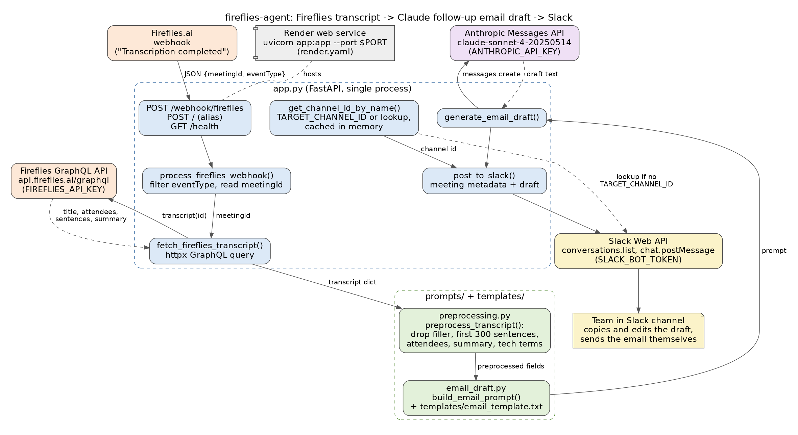

# fireflies-agent

A small FastAPI service that turns finished [Fireflies.ai](https://fireflies.ai) meeting transcripts into draft follow-up emails and posts them to a Slack channel.

When Fireflies sends a `Transcription completed` webhook, the service fetches the transcript from the Fireflies GraphQL API, filters it, asks Claude (Anthropic) to write a follow-up email, and posts the draft with the meeting title, date, duration and transcript link to Slack. **It does not send email**: someone in the channel copies, edits and sends the draft.



See [docs/architecture.md](docs/architecture.md) for the request flow, components, configuration and known limitations. The diagram source is [docs/diagrams/architecture.dot](docs/diagrams/architecture.dot) ([SVG](docs/diagrams/architecture.svg)).

## Repository layout

| Path | Purpose |
| --- | --- |
| `app.py` | FastAPI app: webhook routes, Fireflies fetch, Claude call, Slack post |
| `prompts/preprocessing.py` | Cleans the transcript (drops filler, keeps the first 300 substantive sentences, attendees, summary, tech terms) |
| `prompts/email_draft.py` | Builds the Claude prompt from the preprocessed fields |
| `templates/email_template.txt` | Loose email structure the prompt asks Claude to follow |
| `render.yaml` | Render web service definition (production deploy) |
| `Dockerfile` | Container alternative (runs `python app.py` on port 8000) |
| `PLAN.md` | Historical plan for the Granola to Fireflies migration |

## Configuration

Set these in `.env` (copy `.env.example`) for local runs, or in the Render dashboard for production. The app reads them at import time and exits with a `KeyError` if a required one is missing.

| Variable | Required | Notes |
| --- | --- | --- |
| `SLACK_BOT_TOKEN` | yes | Bot token (`xoxb-...`) with `chat:write` and `channels:read`/`groups:read`; the bot must be in the channel (private channels too) |
| `ANTHROPIC_API_KEY` | yes | Used for `claude-sonnet-4-20250514` |
| `FIREFLIES_API_KEY` | yes | Fireflies API key, sent as a Bearer token |
| `TARGET_CHANNEL_NAME` | no | Channel name to post to. The code and `.env.example` default to `granola-mena-apac`; `render.yaml` sets `fireflies-mena-apac` |
| `TARGET_CHANNEL_ID` | no | Channel ID; skips the name lookup when set (not in `.env.example`) |

`SLACK_APP_TOKEN` is no longer used: the app no longer uses Slack Socket Mode, although `PLAN.md` still lists it.

## Run locally

Requires Python 3.10+ (Render pins 3.11.0).

```bash
python -m venv venv && source venv/bin/activate
pip install -r requirements.txt
cp .env.example .env   # then fill in the keys
python app.py          # serves on http://localhost:8000
```

Or `uvicorn app:app --port 8000`. To receive real webhooks locally, expose the port with a tunnel (for example ngrok) and point the Fireflies webhook at `https://<tunnel>/webhook/fireflies`.

Try it with a recorded meeting ID:

```bash
curl -X POST localhost:8000/webhook/fireflies \
  -H 'Content-Type: application/json' \
  -d '{"meetingId": "<fireflies transcript id>", "eventType": "Transcription completed"}'
curl localhost:8000/health
```

The call above uses the real Fireflies, Anthropic and Slack APIs and posts to the configured channel.

## Deploy (Render)

`render.yaml` defines one Python web service, `fireflies-agent`: build `pip install -r requirements.txt`, start `uvicorn app:app --host 0.0.0.0 --port $PORT`. Set `SLACK_BOT_TOKEN`, `ANTHROPIC_API_KEY` and `FIREFLIES_API_KEY` in the Render dashboard (they are `sync: false`). Then set the webhook URL in the Fireflies dashboard to `https://<service>.onrender.com/webhook/fireflies` (the root path `/` also works).

## Tests

The repository has no automated tests.
