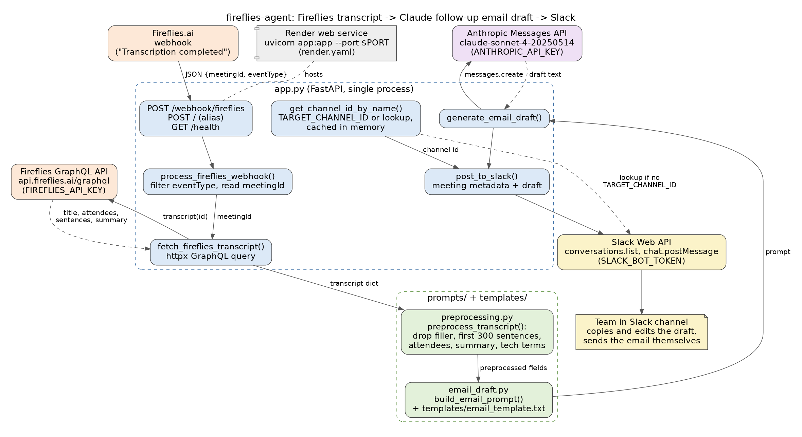

# Architecture

fireflies-agent is a single-process FastAPI service (`app.py`) hosted on Render. It has no database, queue or background worker: each Fireflies webhook is handled inline, from transcript fetch to Slack post, before the HTTP response is returned.

Source: [diagrams/architecture.dot](diagrams/architecture.dot) ([SVG](diagrams/architecture.svg)). After editing it, run `docs/diagrams/render.sh` (needs Graphviz) to regenerate the PNG and SVG.

## Request flow

1. **Webhook.** Fireflies calls `POST /webhook/fireflies` (or `POST /`, an alias) with JSON such as `{"meetingId": "...", "eventType": "Transcription completed"}`. The payload is not authenticated.
2. **Filter.** `process_fireflies_webhook()` returns `{"status": "ignored"}` for any other `eventType`. A missing `meetingId` is rejected (see [limitations](#known-limitations)).
3. **Fetch.** `fetch_fireflies_transcript()` POSTs a GraphQL `transcript(id:)` query to `https://api.fireflies.ai/graphql` with `Authorization: Bearer $FIREFLIES_API_KEY` (httpx, 30 s timeout). It requests title, date, duration, organizer/host, attendees, sentences (speaker, text, start time), the Fireflies summary (overview, action items, keywords, topics) and the transcript URL.
4. **Preprocess.** `prompts/preprocessing.py` `preprocess_transcript()` drops short filler sentences ("okay", "thanks", ...), keeps the first 300 remaining sentences as `Speaker: text` lines, joins attendee display names, pulls overview, keywords and action items from the summary, and flags known technology terms (AI, Azure, GitHub, Devin, ...) found in the text.
5. **Prompt.** `prompts/email_draft.py` `build_email_prompt()` combines the instructions (`SYSTEM_PROMPT`: personalised, substantive, no markdown or bullets, 200-400 words), the meeting details, the filtered discussion and `templates/email_template.txt`. The template is read once at import.
6. **Generate.** `generate_email_draft()` calls the Anthropic Messages API with `claude-sonnet-4-20250514`, `max_tokens=2048`, the whole prompt sent as one user message.
7. **Resolve channel.** If `TARGET_CHANNEL_ID` is unset, `get_channel_id_by_name()` calls Slack `conversations.list` (public and private) and matches `TARGET_CHANNEL_NAME`. The ID is cached in a module global for the life of the process.
8. **Post.** `post_to_slack()` calls `chat.postMessage` with a header (meeting, date, duration in minutes, "View in Fireflies" link) followed by the draft. The response to Fireflies is `{"status": "success", "meeting_id": ..., "title": ...}`.

`GET /health` returns `{"status": "healthy", "service": "fireflies-slack-agent"}`.

## Components

| Component | Where | Role |
| --- | --- | --- |
| FastAPI app | `app.py` | Routes, orchestration, all external calls |
| Preprocessing | `prompts/preprocessing.py` | Transcript cleanup and field extraction |
| Prompt builder | `prompts/email_draft.py`, `templates/email_template.txt` | Claude prompt text |
| Fireflies | webhook + GraphQL API | Trigger and transcript source |
| Anthropic | Messages API | Writes the email draft |
| Slack | Web API (`slack_sdk.WebClient`) | Channel lookup and posting |
| Render | `render.yaml` | Hosts the service (`uvicorn app:app --host 0.0.0.0 --port $PORT`, Python 3.11.0) |

Slack is used only to post: the app does not listen to Slack events and does not use Socket Mode, so `SLACK_APP_TOKEN` is not needed. Nothing sends email; the "email" is a draft in Slack for a person to send.

## Configuration

Required at import time: `SLACK_BOT_TOKEN`, `ANTHROPIC_API_KEY`, `FIREFLIES_API_KEY`. Optional: `TARGET_CHANNEL_NAME` (default `granola-mena-apac`; `render.yaml` sets `fireflies-mena-apac`) and `TARGET_CHANNEL_ID`. `python-dotenv` loads a local `.env`. See the [README](../README.md#configuration).

## Deployment

Render builds with `pip install -r requirements.txt` and starts uvicorn on `$PORT`; secrets are set in the dashboard. The `Dockerfile` is an alternative that runs `python app.py`, which always binds port 8000. Dependencies in `requirements.txt` are unpinned, so each build takes the latest releases.

## Error handling

| Case | Result |
| --- | --- |
| Other `eventType` | 200 `ignored` |
| Body is not JSON | 400 `Invalid JSON payload` |
| Missing `meetingId` | 500 with detail `400: Missing meetingId in payload` |
| Fireflies HTTP error, GraphQL error or network failure | 500 `Failed to fetch transcript from Fireflies` |
| Channel name not found | 500 `Channel '<name>' not found` |
| Claude call fails | The text `Error generating email draft. Please try again.` is posted to Slack as the draft; 200 |
| Slack post fails | Logged only; 200 `success` |

## Known limitations

- The webhook does not verify a Fireflies signature, so any caller who knows the URL can trigger a Claude call and a Slack post.
- The full webhook payload and the raw Fireflies response (the whole transcript) are printed to stdout, so transcripts end up in Render logs.
- The `HTTPException` for a missing `meetingId` is caught by the generic handler and returned as 500, not 400.
- The Slack and Anthropic clients are synchronous and run inside the async handler, and the pipeline runs before the webhook is answered.
- `conversations.list` is read once without pagination, so a channel beyond the first page is reported as not found; setting `TARGET_CHANNEL_ID` avoids the lookup.
- Processing is not idempotent: a repeated webhook for the same meeting posts another draft.
